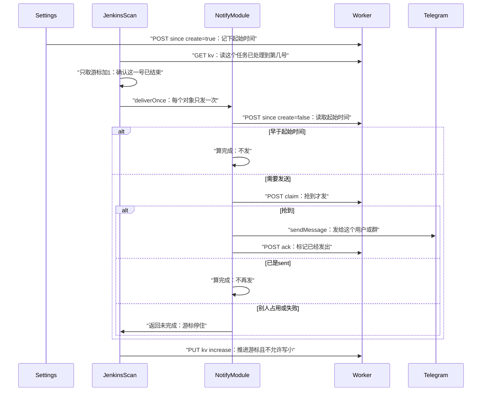

# Telegram 构建完成通知

状态：已实施。本文是给审查用的设计说明。实现时以本文为准，不要去翻已删除的旧通知代码。

构建一结束，每个已配置的 Telegram 用户和群都会收到一条消息。成功、失败、取消都算结束。消息由某台开着的浏览器发出去。Worker 只保证同一个接收对象、同一次构建不会发第二次。

## 1. 目标

- 本机配置过的每一个 Jenkins 环境，里面每一个任务，每一次已经结束的构建，都在每个接收对象里出现一条消息。
- 两台电脑、同一个人配了两次同一个 `chat_id`，都不会因此多发一条。
- 消息发送以后还能给别的功能用。Jenkins 只是第一个调用方。

## 2. 明确不做

- 不做飞书、企业微信、通用 Webhook。
- 不做功能开关、环境开关、任务开关。
- 不由 Worker 发 Telegram。Worker 不保存机器人 Token，不保存正文，不保存 Jenkins 地址和密码。
- 不把游标放进 Dexie。团队同步是后写入覆盖先写入，旧号晚到会把游标盖小。
- 不复用 `src/features/jenkins/api/fetchMyBuilds.ts`。那条链路会丢掉没有用户名的构建，空闲时每个任务只取最近 5 次，别人的最多留 50 条。界面上「只显示自己」只影响显示，不能拿来当通知范围。
- 不恢复历史上已删除的 Jenkins Telegram 通知实现。

## 3. 已锁定的决定

- 结束才发。结果必须是 `SUCCESS`、`FAILURE`、`ABORTED`、`UNSTABLE`、`NOT_BUILT` 之一。
- 所有人的构建都发，包括定时任务和没有触发人的构建。
- 配了机器人 Token，并且至少有一个未删除的接收对象，就开始发。
- Token 和接收对象进团队同步，用现有团队密钥加密。服务器只能看到密文。
- Jenkins 的地址、用户名、密码只留在本机 `jenkins_environments`。
- 去重键用构建 URL，不用构建结果。`…/job/foo/41` 和 `…/job/foo/42` 是两次。
- 游标的值表示「连续处理到这个号」。处理完成包括「已发送」「本来就已发送」「早于该对象起始时间所以不发」。
- 只推进「游标 + 1」。这一号没完成，更后面的号先不看。同一轮里连续完成可以推进多个号。
- 游标写入使用 KV 的 `type=number`、`order=increase`。更小的号不能覆盖更大的号。
- 不同 Jenkins 主机的游标分开。同一个主机上的同一个任务，全队共用一把游标。

## 4. 名词

| 词 | 含义 |
| --- | --- |
| 环境 | 本机 `jenkins_environments` 里的一条。有自己的 `id`、`name`、`host`、`user`、`token`。不参与同步。 |
| 任务地址 | Jenkins 返回的 Job `url`，含主机和路径，不含构建号。文件夹本身不是任务。 |
| 构建地址 | Jenkins 返回的某一次构建的 `url`，路径末尾是构建号。 |
| 接收对象 | 一个 Telegram 用户私聊，或一个群。界面上的「用户 / 群」只用于展示，发送时都走 `sendMessage`。 |
| 起始时间 | 某个功能、某个接收对象从什么时候开始收。更早的事件不发。 |
| 纸条 | Worker 上的一次性发送权。抢到才能发，标成已发送后别人不能再发。 |
| 游标 | 某个任务已经连续处理到的构建号。存在通用 KV 里，不是一张专用游标表。 |

## 5. 分工

消息模块只管发给谁、怎么发。Jenkins 只管哪次构建结束了、正文写什么。

Jenkins 可以调用的只有 `deliverOnce({ scope, dedupKey, text, occurredAt })`。它不读 Token，不读 `chat_id`，不调用 Telegram。

消息模块不解析任务名和构建号，不读写 Jenkins 游标。游标的键和值由 Jenkins 扫描自己传给 KV 接口。

以后别的功能复用同一批接收对象，自己准备正文和去重键，调用同一个 `deliverOnce`。别的功能要游标时，用自己的 KV 键，不新增接口。

## 6. 本机数据

Dexie 从当前 v31 升到 v32。只新增表，不改已有表。两张表都登记进 `src/db/syncEngine.ts` 的同步表名单，并在 `src/lib/sync/dataScope.ts` 的 `TABLE_DATA_SCOPE` 里标成 `team`。删除走现有软删除 `deletedAt`。写入必须走 `src/lib/db/*`，这样同步钩子才会跑。

### notifyConfig

固定一行，主键 `id` 永远是 `default`。

| 字段 | 类型 | 说明 |
| --- | --- | --- |
| id | string | 固定 `default` |
| botToken | string | 机器人 Token。清空时写成空字符串，不删行，这样清空能同步到其他电脑 |
| updatedAt | number | 本机写入时间，供现有后写入覆盖使用 |
| deletedAt | number 或缺省 | 沿用软删除字段。正常清空 Token 不写这个字段 |

没有 `enabled`。`botToken` 去掉首尾空白后为空，就视为没配 Token。

### notifyTargets

| 字段 | 类型 | 说明 |
| --- | --- | --- |
| id | string | 本机生成的 id。只用于本表和起始时间，不是 Telegram 的 `chat_id` |
| kind | `user` 或 `group` | 只给界面区分。不传给 Worker，不传给 Telegram |
| label | string | 给人看的名称，可以为空 |
| chatId | string | 用户输入的 `chat_id`，保存前做第 8 节的规范化 |
| updatedAt | number | 本机写入时间 |
| deletedAt | number 或缺省 | 有值则扫描时忽略 |

不给 Jenkins 加团队表，不加开关，不加本地游标表。

设置导出目前只导出 `settings` 等选定项，不会自动带上这两张新表。Token 和接收对象只随团队同步走，不进现有设置导出文件。`clearAllLocalData` 会清掉它们。已配置个人私钥时的「重建本地数据」会清团队表再拉取，Token 能从同步恢复。

保存规则：

- 没有非空的 `sync_encryption_key`，或没有非空的 `custom_server_url`，保存失败，Dexie 不写。
- 新增接收对象时，先调用 `POST /api/notify/since` 且 `create=true`。失败则这一次保存失败，不写入这行。
- 只改 Token、只改名称、只删除接收对象时，不调用 `since`。
- 删除是软删除。Worker 上已有的起始时间不删。

## 7. Worker 表

迁移文件：`packages/cf-worker-googlesheet/migrations/0004_notify_claims.sql`。路由加在 `packages/cf-worker-googlesheet/src/index.ts`，鉴权沿用现有 `X-Access-Token` 对 `SYNC_ACCESS_TOKEN`。不新建 Durable Object。每张表的写入都放在一个 D1 事务里完成，禁止先查询、再在另一次请求里写入。

### notify_claims

纸条。保证同一个功能、同一个接收对象、同一条去重键只发出去一次。

| 列 | 说明 |
| --- | --- |
| claim_key | 主键。客户端算好的哈希，Worker 不解释 |
| owner_client_id | 当前持有者，等于同步用的 client id |
| status | `leased` 或 `sent` |
| lease_until | 租约到期的 Unix 毫秒，用 Worker 时钟 |
| updated_at | Worker 时钟 |

租约 60 秒。`ack` 不检查租约是否过期，只检查持有者和状态仍是 `leased`。否则一次发得很慢的成功发送会标不上，下一台会再发。

### notify_target_since

接收对象的起始时间。这个时间之前的事件不发。

| 列 | 说明 |
| --- | --- |
| scope | 联合主键的一半。构建通知固定 `jenkins-build` |
| target_id | 联合主键的另一半。等于 `notifyTargets.id`，不是 `chat_id` |
| since_ms | 第一次创建时的 Worker 时钟，Unix 毫秒。之后不改 |

不同功能各自记。后加的人和群用自己的起始时间，不收更早的构建。

### kv_entries

通用键值。调用方自己决定键和值是什么。Jenkins 用它存「这个任务连续处理到第几号」。

| 列 | 说明 |
| --- | --- |
| entry_key | 主键。Jenkins 游标是第 8 节的任务键 |
| value | 字符串。数字也按十进制字符串存 |
| updated_at | Worker 时钟 |

Jenkins 地址、Token、正文都不进这三张表。Worker 能看到的是哈希、构建号、接收对象 id、client id。

## 8. 键和规范化

哈希都是 SHA-256，输入是 UTF-8，连接符是一个 LF（`\n`，不是 CRLF），输出是小写十六进制。

### 任务游标键

```text
SHA-256("jenkins-build" + "\n" + canonicalJobUrl)
```

`canonicalJobUrl` 用 Jenkins 返回的 Job `url`：

1. 去掉首尾空白。
2. 解析为 URL。解析失败则这个任务本轮跳过，不写游标。
3. 协议和主机名改成小写，去掉默认端口。
4. 去掉查询串和片段。
5. 路径去掉末尾的一个 `/`。路径大小写保持原样，因为 Jenkins 路径可能区分大小写。

因此 `https://jenkins-prod.example.com/job/foo` 和 `https://jenkins-test.example.com/job/foo` 是两把游标。`https://Jenkins-Prod.example.com/job/foo` 和全小写主机是同一把。本机把同一个主机配成两条环境，也是同一把。

同一个 Jenkins 用域名和 IP 各配一次，会被当成两把游标。这是第 15 节的已知缺口。

### 构建去重键

`dedupKey` 是对构建 `url` 做和上面相同的规范化。构建号留在路径里。结果不参与。

### 纸条键

```text
SHA-256(scope + "\n" + canonicalChatId + "\n" + dedupKey)
```

`canonicalChatId`：去掉首尾空白；如果全是可选的负号加数字，就按十进制整数去掉前导零后再转回字符串，负号保留。`123`、` 123 `、`0123` 是同一个对象。`@username` 不能保存。

同一个 `chat_id` 配两行，纸条键相同，所以只会发一条。

### clientId

用现有同步客户端 id（`SyncEngine.getClientId()`）。不另造一套浏览器 id。

## 9. 什么时候发

发：

- `building` 不是真，并且 `result` 属于那五个结束状态。
- 构建的 `timestamp` 大于或等于这个接收对象的 `sinceMs`。相等要发。
- 这个接收对象的纸条还不是 `sent`，并且这次抢到了。

不发，但这一号对这个对象算完成，游标可以走：

- `timestamp < sinceMs`。
- 纸条已经是 `sent`。
- Telegram 对这一个 `chat_id` 返回 400 或 403（对象不存在、机器人被拉黑、被移出群）：永久失败，照常 `ack` 吃掉纸条，不再重试。

不发，并且这一号不算完成，游标停住：

- 还在构建，或 `result` 为空。
- `result` 不是那五个值。
- 没有 `timestamp`，或 `timestamp` 不是正数。
- Jenkins 返回 404，这个号不存在。
- 起始时间读不到（`since` 返回 404）。
- 别人正持有未过期租约。
- Telegram 网络失败、429、5xx。
- Telegram 401 或 404：Token 整体不可用，所有对象都停住，修好 Token 后继续。
- Telegram 已经成功，但 `ack` 失败。
- Worker 401、400、429，或 KV 返回的值非空且不是十进制整数。空串表示游标 0，见第 11 节。

所有浏览器都关着时，游标没有人推进，下一台开机从停住的号继续，不丢。清空 Token 或没有未删除的接收对象时，闹钟直接返回，游标不动。Token 和原接收对象都还在时，空档里结束的构建会补发。

用户要先私聊过这个机器人才能收到。群里要已经有这个机器人才能收到。

正文由 Jenkins 拼好，纯文本，不设置 `parse_mode`：

```text
[{环境名}] {任务名} #{次数} {结果}
触发：{触发人}
{构建地址}
```

环境名用 `jenkins_environments.name`。任务名用 Jenkins 的 `fullName`，没有则用 `name`。触发人取这次构建 causes 里的 `userName`，没有则用 `userId`，再没有则写「自动」。不要用当前登录的 Jenkins 用户顶上。

## 10. 客户端时序

所有 Worker 请求都带 `X-Access-Token`。Token、正文、Jenkins 地址不放进 Worker 请求。Token 不进日志，也不要记录带 Token 的 Telegram URL。

闹钟名 `jenkins-build-notify-alarm`，`periodInMinutes: 1`。在 `src/entrypoints/background/backgroundLifecycle.ts` 现有的 `alarms.onAlarm` 里加分支，不另挂一个监听器。扩展启动时创建；同名闹钟已在就不要重复创建。内存里如果上一轮还没跑完，这一轮直接跳过。服务工作线程被杀掉时锁会消失，两轮可能重叠；重叠是安全的，因为纸条和 `order=increase` 会挡住重复发送和游标回退。侧边栏关着也跑。不要挂到 Jenkins 界面的轮询上，那个轮询在页面隐藏时会变慢。

### 保存消息配置

1. 检查团队同步密钥和服务器地址。意图：没有密钥就不能把 Token 同步给全队。
2. 新增接收对象时，先 `POST /api/notify/since`，`create=true`。意图：用 Worker 时钟记下起始时间，更早的构建不补发。已有记录不改时间。
3. 成功后再写 Dexie。意图：全队用同一个机器人和同一批接收对象。
4. 删光接收对象或清空 Token 时不调用 Worker。意图：先停发，起始时间留着。

### 每分钟扫描

没有 Token，或没有未删除的接收对象，就结束。

环境按 `order` 升序，同一环境里的任务按规范化后的任务地址升序。单次最多处理 20 次构建，所有环境、所有任务合计。这个 20 还没有产品确认，见第 15 节。某个环境缺主机、缺用户或然密码为空，跳过这个环境，继续下一个。某个环境 401 或网络失败，跳过这个环境，不影响其他环境。

发现任务时，每个环境自己发 Jenkins 请求，使用该环境的地址和账号。任务树与现有 `src/features/jenkins/api/fetchJobs.ts` 一样，最深 10 层、最多 5000 个节点。只给「有自己的 `lastBuild`」的 Job 建游标。文件夹不建。超出深度或节点上限的任务本轮看不到。

对每个任务：

1. `GET /api/kv?key=`。意图：读这个主机上的这个任务已经连续处理到第几号，避免重走历史。没有值就从 0 开始。
2. 看 `lastBuild.number`。意图：知道最大号是多少。没有 `lastBuild`，或最大号小于等于游标，这个任务结束。
3. 取「游标 + 1」这一号，不取最新一号。意图：中间有失败时，不能被后面的成功号带过去。还在构建、结果未出、结果不在五种之内、没有时间戳、或 404，就结束这个任务，不写 KV。
4. 拼好正文，调用 `deliverOnce`。意图：每个接收对象只发一次。返回未完成就结束这个任务，不写 KV。
5. `PUT /api/kv`，`value` 为这一号的十进制字符串，`type=number`，`order=increase`。意图：这一号全部处理完后推进游标，并且不允许写小。
6. `updated` 为真：游标改成这一号，预算减一，还有余量就继续下一号。
7. `updated` 为假且响应里的值是更大的整数：改用那个值，从它后面继续。意图：别的电脑已经推得更远，跟上它，不把中间号再处理一遍。
8. `updated` 为假且响应值小于或等于刚提交的号：结束这个任务。意图：避免同一分钟里对同一个号空转。下一分钟再试。

### deliverOnce

接收对象按 `id` 升序，忽略 `deletedAt`。一个对象未完成时，后面的对象本轮不再处理。

1. `POST /api/notify/since`，`create=false`。意图：只读取起始时间，扫描方不能把起始时间写成现在。404 则整次 `deliverOnce` 未完成。`sinceMs` 创建后不再改，一次扫描内按接收对象缓存，不为每次构建重复请求。意图：压住 Worker 请求量，躲开网关限流（见第 12 节）。
2. `occurredAt < sinceMs`。意图：这个对象还不该收到这么早的构建。这个对象算完成，不抢纸条。
3. `POST /api/notify/claim`。意图：抢到才发，避免两台浏览器同时给同一个对象发同一条。
4. `granted` 为假且 `status` 是 `sent`。意图：已经发过。这个对象算完成。
5. `granted` 为真：浏览器 `sendMessage`。意图：把正文发到这个用户或群。成功后再 `POST /api/notify/ack`。意图：告诉 Worker 已经发出。`ack` 的 `updated` 不是真，则整次未完成。
6. Telegram 对这个 `chat_id` 返回 400 或 403。意图：永久失败，重试无意义。照样 `ack` 把纸条标成 `sent`（`ack` 失败则按未完成处理，下一分钟会重新走到这一步），这个对象算完成，其他电脑也不会再为这一条重试。
7. `granted` 为假且仍是 `leased`，或 Telegram 429、5xx、网络失败、401、404。意图：临时失败或 Token 整体失效，游标停在这一号，下一分钟重试。已经成功的对象下次会在第 4 步算完成，不会再发。

每个未删除的接收对象都算完成时，`deliverOnce` 才返回 `{ complete: true }`。



## 11. 扫描一个任务

```text
游标 = GET /api/kv
如果 value 为空：游标 = 0
如果 value 非空且不是十进制整数：这个任务结束
如果没有 lastBuild，或 lastBuild.number <= 游标：这个任务结束
number = 游标 + 1
取这一号
如果 404、还在构建、结果为空、结果不在五种之内、没有正的 timestamp：结束，不写 KV
complete = deliverOnce(这一号)
如果 complete 不是真：结束，不写 KV
写回 = PUT /api/kv，value = number，type = number，order = increase
如果 updated 为真：游标 = number，还有预算就继续
如果 updated 为假且返回值 > number：游标 = 返回值，还有预算就继续
否则：这个任务结束
```

因此不会出现「A、B 发送失败，C 成功并把游标推过 A、B」。C 要等 A、B 都完成才会被取出来。A 失败时，下一分钟还是从 A 开始。A 其实早就发过时，纸条已是 `sent`，`deliverOnce` 直接算完成，游标再往前。

两台电脑同时读到 40：都只处理 41。后写入的同一号还是 41。一台已经写到 43，另一台再提交 41 时，服务端不改，并返回 43。调用方从 44 继续。晚接入的电脑读到的是当前号，不用从起始时间把历史重走一遍。大家都关着的时候没有人推进，晚接入的电脑仍会补这段漏掉的号。

`deliverOnce` 内部按每个接收对象比较起始时间。扫描伪代码不再单独写「早于起始时间」，避免看起来好像所有对象共用一个起始时间。全部对象都早于自己的起始时间时，`deliverOnce` 仍返回完成，游标前进，但不发消息。

## 12. 接口

下面每个 Worker 接口都要带请求头 `X-Access-Token`。缺少或错误返回 401，响应体 `{ "error": "Unauthorized" }`，与网关现有一致。所有接口共用网关限流：按 Token 加路径分桶，每分钟 180 次，超限返回 429，响应体 `{ "error": "Rate limit exceeded" }`。客户端把 429 当未完成处理，下一分钟重试。JSON 字段缺失、类型不对、`type=number` 但值不是十进制整数，返回 400，响应体 `{ "error": "bad_request" }`。业务上的「没抢到」「没写成」仍返回 200，不使用 409。Worker 不解释键和去重键的业务含义。

键最长 128 个字符。值最长 1024 个字符。`scope`、`targetId`、`clientId` 最长 200 个字符。超出返回 400。

### GET /api/kv

按键读取。没有这个键时 `value` 为空字符串，仍然是 200。

| 参数 | 位置 | 必填 | 说明 |
| --- | --- | --- | --- |
| key | 查询字符串 | 是 | 调用方自己定的键。Jenkins 游标见第 8 节 |

| 响应字段 | 说明 |
| --- | --- |
| key | 请求里的键 |
| value | 当前值。没有记录时为空字符串 |

### PUT /api/kv

按键写入。没有这个键就新建，这时不看 `order`。已有则按 `order` 决定是否更新。比较和写入在同一个事务里。Jenkins 游标传 `type=number`、`order=increase`。普通覆盖不传 `type` 和 `order`。

| 参数 | 位置 | 必填 | 说明 |
| --- | --- | --- | --- |
| key | 请求体 | 是 | 要写入的键 |
| value | 请求体 | 是 | 要写入的值，一律用字符串传递 |
| type | 请求体 | 否 | `string` 或 `number`，默认 `string`。`number` 时两边都按整数比较，不按文本 |
| order | 请求体 | 否 | `any`、`increase` 或 `decrease`，默认 `any`。`any` 直接覆盖。`increase` 只有新值更大才写入。`decrease` 只有新值更小才写入。`type=string` 时按 UTF-8 字节序比较（SQLite BINARY 排序） |

相等不算更大，也不算更小。不满足 `order` 时不改表。

| 响应字段 | 说明 |
| --- | --- |
| key | 请求里的键 |
| value | 这次调用结束后表里的值。没写成时仍是原来的值 |
| updated | 这次是否写入。不满足 `order` 时为 `false` |

### POST /api/notify/since

读取或创建某个功能、某个接收对象的起始时间。

| 参数 | 位置 | 必填 | 说明 |
| --- | --- | --- | --- |
| scope | 请求体 | 是 | 功能名。构建通知固定为 `jenkins-build` |
| targetId | 请求体 | 是 | `notifyTargets.id`，不是 Telegram 的 `chat_id` |
| create | 请求体 | 是 | `true` 只给保存新对象用：没有记录就写入当前 Worker 时间。`false` 只给扫描用：没有记录返回 404，不创建 |

已有记录时，无论 `create` 是真是假，都原样返回，不修改 `sinceMs`。404 的响应体是 `{ "error": "not_found" }`。

| 响应字段 | 说明 |
| --- | --- |
| scope | 请求里的功能名 |
| targetId | 请求里的接收对象 id |
| sinceMs | 起始时间，Unix 毫秒 |

创建必须是 `INSERT ... ON CONFLICT DO NOTHING` 后再读取。两台同时创建时，谁先写入谁的时间留下。

### POST /api/notify/claim

抢纸条。整个判断是一条带条件的 upsert，不先查再改。

成功插入，或同时满足下面任一条，才把持有者改成这次的 `clientId`，状态保持或改回 `leased`，并把 `lease_until` 设为现在加 60 秒：

- 当前状态是 `leased`，而且 `lease_until` 已经小于现在。
- 当前状态是 `leased`，而且持有者就是这次的 `clientId`。同一台重试可以续租。

已经是 `sent` 则不改。别人持有且租约未过期则不改，也不要延长别人的租约。

| 参数 | 位置 | 必填 | 说明 |
| --- | --- | --- | --- |
| claimKey | 请求体 | 是 | 第 8 节的纸条键 |
| clientId | 请求体 | 是 | 同步客户端 id |

| 响应字段 | 说明 |
| --- | --- |
| granted | 这次请求结束后，持有者是这个 `clientId` 且状态是 `leased` |
| status | 表里现在的状态，`leased` 或 `sent` |

### POST /api/notify/ack

把纸条改成已发送。条件是 `claim_key` 相同、`owner_client_id` 相同、状态仍是 `leased`。不看 `lease_until`。

| 参数 | 位置 | 必填 | 说明 |
| --- | --- | --- | --- |
| claimKey | 请求体 | 是 | 与抢纸条时相同的键 |
| clientId | 请求体 | 是 | 必须是当前持有者 |

| 响应字段 | 说明 |
| --- | --- |
| updated | 是否已改成 `sent`。条件不符时为 `false`，表不变 |

### Telegram sendMessage

浏览器直接发给 Telegram，不经过 Worker。地址是 `POST https://api.telegram.org/bot<token>/sendMessage`。Token 来自本机 `notifyConfig.botToken`。

| 参数 | 位置 | 必填 | 说明 |
| --- | --- | --- | --- |
| chat_id | 请求体 | 是 | 规范化后的一个接收对象 |
| text | 请求体 | 是 | 第 9 节的正文 |

HTTP 2xx 且 Telegram 的 `ok` 为真，才算发送成功，然后才能 `ack`。Telegram 返回 400 或 403 视为这个对象的永久失败：同样 `ack` 把纸条标成 `sent`，算完成，不再重试。其余情况（401、404、429、5xx、网络错误）都算这个对象未完成。

## 13. 并发

| 情况 | 结果 |
| --- | --- |
| 两台同时处理 41，都抢到不同接收对象 | 每个对象只有一张纸条，各发各的。两台都会等自己负责的对象完成。游标两次都写成 41 |
| 两台同时给同一个对象抢 41 | 一条 upsert 只有一个持有者。另一台看到 `leased`，游标不动。60 秒后如果还没 `ack`，另一台可以接手 |
| 一台写到 43，另一台再写 41 | `order=increase` 拒绝，返回 43。落后的那台从 44 继续 |
| 先 GET 到 40，中间别人写成 43，再 PUT 41 | 仍然拒绝。先读再写不能代替服务端的 `order` |
| 同一台在租约内又抢一次 | 续租，`granted` 为真。发送前如果上次已经发出但没 `ack`，可能再发一条 |
| 发送成功，`ack` 没到，租约过期 | 另一台可以再抢，再发一条。这是接受的缺口 |
| 新电脑晚接入，游标已是 100 | 从 101 开始。不补 1 到 100。这 100 次若当时没人在线，游标不会是 100 |

起始时间用 Worker 时钟。构建的 `timestamp` 用 Jenkins 时钟。两台钟不一致时，紧挨着起始时间的那一次可能被算成更早或更晚。

持有 `SYNC_ACCESS_TOKEN` 的人可以改 KV 和纸条，从而压住通知或把游标推走。这和现有同步接口的信任边界相同。他看不到机器人 Token 和 Jenkins 密码。

## 14. 代码放哪

- 消息模块：新目录 `src/features/notify/`。对外只有 `deliverOnce`。读 `notifyConfig` 和 `notifyTargets` 走 `src/lib/db/*`。
- 扫描：新文件放在 Jenkins feature 下，由 `backgroundLifecycle.ts` 的闹钟调用。它调用 `deliverOnce` 和 KV，不调用 Telegram。
- 设置：设置页增加「消息」区。只有机器人 Token，以及接收对象列表（名称、用户或群、`chat_id`）。Jenkins 界面、`JenkinsEnvManager`、`JenkinsView` 不加任何通知控件。
- `data-testid` 固定为：`notify-bot-token`、`notify-target-list`、`notify-target-add`、`notify-target-label`、`notify-target-kind`、`notify-target-chat-id`、`notify-target-remove`、`notify-save`。

## 15. 已知缺口

这些是当前规则下就会发生的问题，审查时逐条决定是接受还是改规则。

1. Telegram Token 失效（401、404）时所有发送停住，所有任务的游标停在各自的下一号，直到 Token 修好。Worker 或 Telegram 长时间 5xx、或持续被 429 限流时同样停住。写错的 `chat_id` 不再挡住别人：400、403 会吃掉纸条算作完成，只有写错的那一行永远收不到。
2. Jenkins 丢弃了中间某个构建号时，取这一号得到 404，游标永远停在它前面。后面的新构建也不会发。
3. 起始时间按 `notifyTargets.id` 记。只清空 Token、行还在，配置加回来会补空档。删掉接收对象再新建同一 `chat_id`，id 变了，起始时间是新建时刻，中间空档不补。这和「配置加回来要补空档」只在「行还在」时成立。
4. 扫描如果误用 `create=true`，会把还没保存成功的对象起始时间写成扫描时刻，更早的构建被丢掉。实现必须保证只有保存新对象才传 `create=true`。
5. 游标从 0 开始时，早于起始时间的历史号也要一号一号取完才能推进。一个有上万次构建的任务，按每分钟 20 号，要很多分钟才追上现在。预算被 `order` 靠前的环境先用掉时，后面的环境会饿死。
6. 同一个 Jenkins 配了两个不同主机名时，游标和纸条都是两套，同一构建会发两遍。
7. 发送已经成功但 `ack` 失败时，大约 60 秒后可能再发一条。Telegram 本身超过 60 秒时也同样。
8. 不认识的 `result`、缺少 `timestamp`，都会让这个任务的游标停住。
9. 任务树超过 10 层或 5000 个节点的部分，不会被通知。
10. 任务在 Jenkins 上重命名或移动后，构建地址里的路径变化，`dedupKey` 和游标键都变。新游标从 0 开始，自起始时间以来的构建会按新地址重发一遍。
11. KV 的值被手工改成非十进制整数时，这个任务的游标永远停住。客户端没有自恢复，只能由持有 `SYNC_ACCESS_TOKEN` 的人手工修正。

## 16. 测试

消息模块：

- 同一 `scope + chat_id + dedupKey` 只有一张纸条。
- 同一 `chat_id` 写成两行只发一条。
- `123` 和 `0123` 只发一条。
- 不同 `scope` 各发各的。
- `occurredAt` 小于 `sinceMs` 算完成且不调用 Telegram。相等要发。
- `create=false` 且没有起始时间时返回未完成，并且 Worker 不新增记录。
- 第一个对象已 `ack`、第二个发送失败时，下一次第一个不再发，第二个会重试。
- Telegram 返回 400 或 403：纸条照样 `ack` 成 `sent`，这个对象算完成，之后不再重试。
- Telegram 返回 401 或 404：整次 `deliverOnce` 未完成，纸条不 `ack`。
- Worker 返回 429：按未完成处理，游标不动，下一分钟重试。

KV：

- 没有键时 `increase` 直接插入。
- 已有 43 时写入 41，`updated` 为假，值仍是 43。
- 写入与当前值相等，`updated` 为假。
- `order=any` 可以用更小的值覆盖。
- `type=number` 拒绝 `41abc`。
- 比较和写入在并发时不会让 41 覆盖已经写上的 43。

Jenkins：

- 第 41 次和第 42 次的 `dedupKey` 不同。
- 两个主机、相同任务路径，游标键不同。主机只是大小写不同，游标键相同。
- 候选包含他人的构建和没有用户名的构建。
- 扫描前先读 KV。连续三号都完成时，一轮内游标前进 3，且每次只取下一号。
- 下一号未结束、404、或 `deliverOnce` 未完成时不写 KV。
- 扫描的是全部 `jenkins_environments`，不看 `jenkins_current_env`。
- 本机没有 Token 或没有接收对象时，不请求 Jenkins，也不写 KV。
- 返回的游标比本地提交的更大时，从返回值后面继续，不补中间号。
